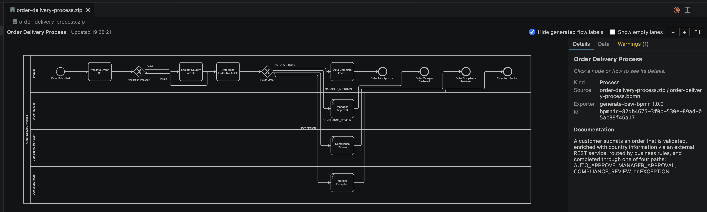
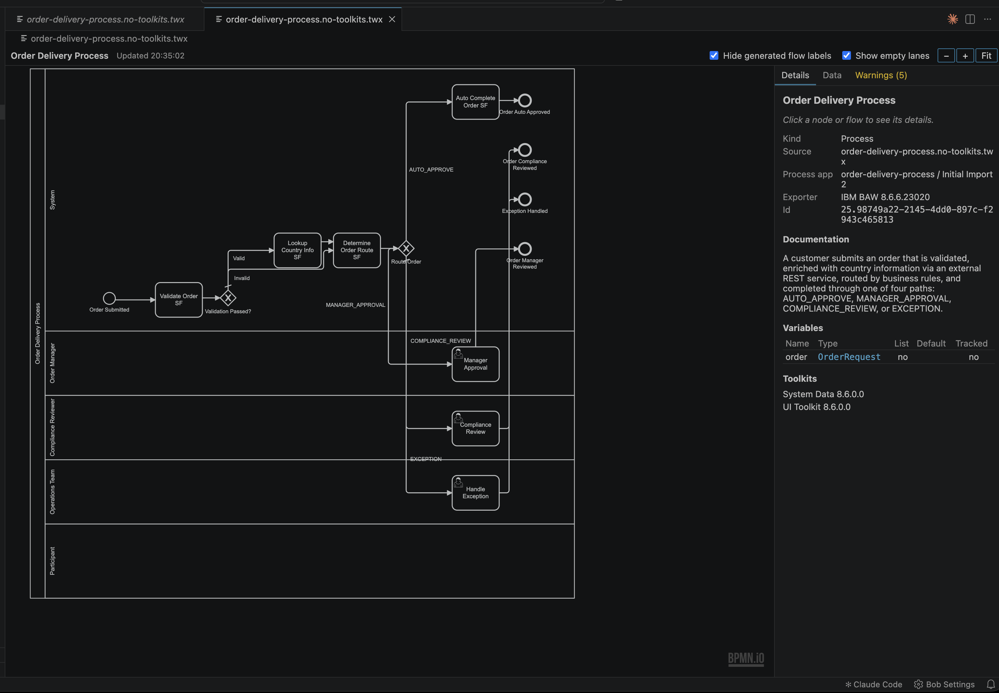

# Lanescope

[](https://github.com/selcukc34/lanescope/actions/workflows/ci.yml)

> Not affiliated with or endorsed by IBM. See [Trademarks](#trademarks).

A read-only extension for IBM Bob (a VS Code based IDE) that renders IBM Business Automation Workflow (BAW) processes as BPMN diagrams. It opens the process files Bob produces and IBM BAW `.twx` exports, and never writes, changes, or deploys them.





The same process after a round trip through IBM BAW, drawn with BAW's own layout.

## Installation

Lanescope is an extension for IBM Bob and is in preview. It is tested with IBM Bob 2.2.2 (VS Code 1.126) and needs VS Code 1.85 or later.

### From Open VSX

In IBM Bob, open the **Extensions** view (Cmd+Shift+X on macOS, Ctrl+Shift+X on Windows and Linux), search for **Lanescope** and click **Install**. IBM Bob installs it from [Open VSX](https://open-vsx.org/extension/selcukc/lanescope).

Listing: [open-vsx.org/extension/selcukc/lanescope](https://open-vsx.org/extension/selcukc/lanescope)

### From a GitHub Release (.vsix)

For corporate networks without access to Open VSX, or to install a specific version:

1. Download `lanescope-<version>.vsix` from the [Releases](https://github.com/selcukc34/lanescope/releases) page.
2. In IBM Bob, open the **Extensions** view, click **…** (Views and More Actions) at the top of the view and choose **Install from VSIX...**.
3. Pick the downloaded file and reload the window if asked.

To update, install the newer `.vsix` the same way. To remove the extension, find **Lanescope** in the Extensions view and choose **Uninstall**.

## Open a process

- Right-click a `.bpmn`, `.zip` or `.twx` file in the Explorer and choose **Lanescope: Open**, or
- run **Lanescope: Open** from the Command Palette, or
- use **Open With... → Lanescope** on the file.

The viewer is never the default editor for these file types, so `.zip` and `.bpmn` files still open as before unless you pick the viewer.

### Toolbar

| Control | Effect |
| --- | --- |
| **Hide generated flow labels** | Hides flow names that only repeat the target ("To &lt;target&gt;"). Condition and default flows keep their label. On by default. |
| **Show empty lanes** | Draws lanes that hold no nodes. On by default for a `.twx` export (BAW draws them, with their BAW height); off for Bob output, where the Warnings tab lists them instead. |
| **Highlight changes** | Marks added (green) and changed (amber) elements of the [comparison](#comparing-versions) in the diagram. On by default; the Changes tab lists them either way. |
| **−**, **+**, **Fit** | Zoom out, zoom in, fit the diagram to the window. |
| **Compare…** | Compares the diagram with another file (see [Comparing versions](#comparing-versions)). |
| **Trace** ▾ | Checks the process against a description (see [Description traceability](#description-traceability)). **Trace** opens the Trace tab, or asks for a description when none is attached; a badge counts the missing items. **▾** opens **Check Against Description…**, **Open Process Description** (**New Process Description** while `<name>-description.md` is not there yet) and **Clear Description Check**. |
| **Search…** | Finds a word anywhere in the open file (see [Search](#search)). **Cmd/Ctrl+F** focuses it, **Escape** clears it. |
| **Export** | Exports the shown diagram to a new file (see [Export](#export)). |

Click a node, flow or lane to select it: the selected element is drawn with a thicker border in the theme's focus colour and a glow (a lane or pool with a dashed border), and the details panel shows it. A row of the Changes or Trace tab selects its element the same way. Exports never show the selection.

Changing a toggle redraws the diagram and keeps the zoom and the selection. The toggles keep their state across live refresh, the process selector and opened services; the default by input type applies only when the file is first opened.

## Supported inputs

| Input | What is read |
| --- | --- |
| `.bpmn` (Bob output) | The BPMN process. The `.xsd` files in the same folder supply the business object types. |
| `.zip` (Bob output) | One `.bpmn` and its `.xsd` files inside the archive. |
| `.twx` (IBM BAW export) | Every BPD (business process definition) in the process app, with BAW's own lanes and positions. |

Bob output has no diagram coordinates, so the viewer lays it out automatically: lanes become horizontal bands and flows are routed orthogonally.

### TWX exports

A `.twx` export can hold several BPDs. Each one is a process in the viewer; when there is more than one, pick it in the toolbar's selector.

- Nodes, flows, names, conditions and documentation come from the BPMN2 model BAW stores in each BPD. Lanes, lane heights and positions come from BAW's own diagram model, so the diagram keeps the layout of the BAW editor. Empty lanes, which that model leaves out, come from the BPMN2 model with their BAW height. Flows leave and enter nodes through the sides BAW saved for them and are routed around the other nodes. A BPD without positions is laid out automatically.
- The details panel names the service or process a call activity calls. The Data tab lists the process app's business objects.

### Opening called services and linked processes

A call in a `.twx` export can be opened as a diagram of its own: a service flow, a client-side human service or a linked process. From there you can open the services it calls in turn, as deep as the calls go.

- Select the call and click **Open diagram** (**Open process** for a linked process) in the details panel, or double-click the call in the diagram.
- Service flows and human services are drawn with the positions of the BAW editor, in one pool without lanes. A linked process is drawn with its lanes, like a process picked in the selector. A service without positions is laid out automatically.
- The breadcrumb above the diagram shows the path, e.g. **Main Process › Weather Lookup › Get Weather**. Click a part to go back to that level; **Back** or **Escape** goes up one level. Each level gets its zoom and selection back when you return to it.
- A call that is already open higher up in the path goes back to that level instead of opening it again, with the note "… is already open in this path". A path holds at most 20 levels.
- Calls that cannot be opened say why instead of showing a button: **Not in this export** (for example System Data's SQL Execute Statement and other toolkit services) or **External service** (REST steps and external services).
- Picking another process in the selector starts a new path.
- A service is read when it is first opened, not when the file is opened.

In a service diagram, clicking the empty canvas shows the service's kind (**Service flow** or **Client-side human service**) with its **Inputs**, **Outputs** and **Variables**. Selecting a coach shows its **Control · Type · Binding** table. Scripts, calls with their mappings, REST steps, gateway conditions and error boundaries show the same details as elsewhere. The validation rules (Warnings tab) run on processes only, not on service diagrams.

### Opening sub-processes

A sub-process (and an event sub-process) is drawn collapsed in its process. Its inside opens as a diagram of its own, one level below, in the same way as a called service, in Bob output and in `.twx` exports.

- Select the sub-process and click **Open sub-process** in the details panel, double-click it in the diagram, or click the drill-down arrow at its lower right corner, which shows while a sub-process that opens is selected. The details panel shows how many nodes it contains (**Contains**: the nodes drawn when it is opened). A sub-process without nodes shows **Empty sub-process** and does not open.
- The inside is drawn in one pool named after the sub-process, with the sub-process's own lanes: in BAW a sub-process has lanes of its own, independent of the process lanes (by default one lane, **All Users**); in Bob output, a `bpmn:laneSet` inside the `bpmn:subProcess`. Without them it is drawn without lanes. **Show empty lanes** applies as in the process. A sub-process inside it is drawn collapsed again and opens as one more level. Boundary events come with the node they are attached to.
- In a `.twx` export the lanes (names, order, heights) and the node positions are those of the BAW editor's sub-process diagram, when the export holds it; otherwise, and for Bob output, the inside is laid out automatically. The details panel shows the lane of the sub-process's own diagram.
- The breadcrumb shows the path, e.g. **Main Process › Sub1**, with the kind **Sub-process** or **Event sub-process**; going back, Escape, zoom and selection work as for called services.
- The Warnings tab of a sub-process level lists no validation results of its own: the rules already check the inside of every sub-process when they run on the process.

### Details panel

Click a node to see what the source holds for it. A section appears only when the source has that information.

| Selection | Shown |
| --- | --- |
| Script task | The script as stored, with its line count, a **Copy** button and, for scripts longer than 20 lines, **Show all N lines**. |
| Call (system task, user task, linked process) | **Input mapping** (Parameter, Type, Value) and **Output mapping** (Parameter, Target) for every parameter of the called service or process. A parameter the caller leaves unmapped shows **not mapped**; a literal value is shown without its quotes and marked **literal**. |
| Call of a service (TWX) | **Inside &lt;service&gt;**, folded: the steps of the called service flow or client-side human service in flow order (script, call, REST, gateway, coach, event), one level deep. Scripts fold with the same code block; calls show what they call and their mappings; REST steps the external service and operation; gateways every outgoing flow with its condition (**no condition** when it has none) and the default; error boundaries what they catch (**catches: all** or the error code) and where they lead. Then the service's **Inputs**, **Outputs**, **Variables** and, for a human service, a **Control · Type · Binding** table per coach. A service with nothing between start and end says so. |
| Linked process | **Open process** opens the called process below the current one (see the breadcrumb) when the export holds it. |
| Sub-process | **Contains**: the number of nodes inside it, and **Open sub-process** (see [Opening sub-processes](#opening-sub-processes)). |
| Coach (in a human service diagram) | **Controls**: Control · Type · Binding of every control of the coach. |
| Error boundary (in a service diagram) | The step it is attached to and what it catches (**all** or the error code). |
| User task | **Assignment**: assignment type, lane, performer, priority, due date and subject. |
| Timer event | Duration and unit; for a boundary timer also whether it interrupts and repeats. |
| Gateway | **Outgoing conditions**: target, condition and default flow of every outgoing flow (also for Bob output). |
| Empty canvas | The process: its **Inputs**, **Outputs** and **Variables** (type, list, default value, tracked). |

The viewer only shows what is in the file. It does not judge, score or rewrite any of it.

## Export

**Export** in the toolbar, or **Lanescope: Export Diagram…** in the Command Palette, saves the diagram that is shown (the chosen process, or the service flow or linked process opened below it) to a new file:

| Format | What you get |
| --- | --- |
| **BPMN with layout, no scripts** (`.bpmn`) | BPMN 2.0 XML with diagram interchange: the layout the viewer computed is stored as coordinates, so other BPMN tools (and Lanescope) draw it as shown. |
| **SVG image** (`.svg`) | The diagram as a vector image. |
| **PNG image** (`.png`) | The diagram at twice its size, scaled down for very large diagrams (at most 16384 pixels a side and 64 megapixels). |

- A save dialog asks where to save. It opens in the folder of the last export (while that folder exists), else next to the opened file. The suggested name is `<file>.laid-out.bpmn`, `<file>.svg` or `<file>.png`, with the name of an opened service flow or linked process added (`<file>-<level>.svg`), and `-2`, `-3`, … when that name is taken.
- An export always goes to a new file. The opened file and the files of its package are never written: the save dialog refuses the opened file itself, any `.twx`, `.zip` or `.xsd` file, and a file with another extension than the format's.
- Exports hold every flow name and every lane: the toolbar toggles change only what the viewer shows. Gateway conditions and documentation (as plain text) are kept.
- The BPMN export is a diagram and layout export, not a complete process to import back into BAW. Script code is never included, in any format: script tasks are exported without their script.
- Images are drawn in light colours (white fill, black lines, on a white background) whatever the VS Code theme.
- For a `.twx` export, ids that are not valid XML ids are replaced by safe ids (as in the viewer); the original BAW ids are not in the exported BPMN.

## Live refresh

The viewer watches the opened file and re-reads it 300 ms after the last change. For a `.zip` or `.twx` it watches that file itself. For a `.bpmn` it also watches the `.xsd` files in the same folder. A file that is deleted and written again (as Bob may do) is picked up too.

- Zoom, scroll position and the selected element (if its id still exists) are kept. The toolbar shows **Updated hh:mm:ss**: the last time the file was read.
- An opened service or linked process stays open. If a level of the breadcrumb is no longer in the file, the viewer stays at the deepest level that still is and says so in a short note.
- If the new file cannot be read, the last good diagram stays on screen and the error is shown in a banner above it. You can dismiss the banner with **×**. It goes away by itself once the file is fixed.

## Comparing versions

The **Changes** tab lists what was added, removed or changed in the shown process compared with another version of it: nodes, flows, lanes, the process itself (name, documentation, variables) and business objects (XSD or TWX data types, field by field). With **Highlight changes** on, added and changed elements are marked in the diagram; removed ones are listed only. Click an added or changed node, flow or lane (or press Enter on it) to select it, scroll it into view and show its details.

What it is compared with:

- **A file you pick.** **Compare…** in the toolbar, or **Lanescope: Compare With…** in the Command Palette or the editor's **…** menu, asks for a `.bpmn`, `.zip` or `.twx` file. The picked file is the older side: the tab lists the changes from it to the shown file ("Changes from &lt;file&gt; to the shown file"), so pick the earlier version while the newer one is open. The side panel switches to the Changes tab once the file is read. It is read once, like an opened file (same readers and size limits), and never watched or written. It may be in another format than the opened file, for example a Bob `.zip` against its BAW `.twx` export. The file stays the base across live refresh until **Clear** in the Changes tab or **Lanescope: Clear Comparison**.
- **The previous version.** Without a picked file, each live refresh compares the new version with the one shown before it, so after Bob generates the process again the viewer shows what changed. The comparison stays until a refresh brings a version that differs from the shown one; that refresh compares with the version before it. A refresh with the same content (the file touched, or Bob writing the same process again) keeps the comparison and its time, so the changes stay on screen. Only the shown process and the business objects count, not the file bytes or the layout. When a file is first opened there is nothing to compare yet.

How elements are paired: by id first (Bob keeps its ids when it generates a process again), then by name and kind among the rest (BAW ids change between exports), then by neighbours, which catches a renamed node whose id changed too: same kind, same lane, and the same nodes before and after it. A name or neighbourhood that is not unique pairs nothing, so the element shows as removed and added. Flows pair by id, else by their source and target; lanes by id, else by name. Another process of the package picked in the toolbar is compared with the process of the same id or name in the base.

- Positions, sizes, label positions and ids are not compared: a different layout or a new id alone is not a change.
- Script code is never shown: a changed script is listed as "Script changed", whatever `lanescope.showScripts` says. Changed mappings list the parameter names only, not the mapped values. Long documentation and conditions are cut to 80 characters.
- Only processes are compared. Inside an opened service flow or linked process, the Changes tab says so.
- Sub-processes are part of their process. The lanes of a sub-process's own diagram pair like the process lanes (by id, else by name) within each pair of sub-processes. A collapsed sub-process with added, changed or removed elements inside it (its lanes included) is marked changed, and its row says **Inner changes: N**. Inside an opened sub-process the Changes tab lists the comparison of the process, and the elements drawn there are marked. A row of an element that is not drawn at the shown level selects the sub-process that holds it.
- Exports never hold the change marks.

## Lanescope description format

A process description is a Markdown file. Lanescope checks four `##` sections; their headings must be written exactly as below (any case). Every other heading is free text and is not checked (for example *Business scenario*, *Validation rules*, *Routing rules*, *Expected output*).

- `## Main process steps` (required): a numbered or bulleted list. Each item is the name of an activity, gateway or event, in order.
- `## Gateway paths` (optional): a list of the names of a gateway's outgoing flows. Say which gateway with "after &lt;step&gt;" in a sentence above the list ("The gateway after Determine Order Route should have four outgoing paths:"), or with a `### After <step>` sub-heading. Use one `### After <step>` per gateway to describe several gateways. Without either, the paths may belong to any gateway. In the sentence, the step name ends at *should*, *must*, *shall*, *will*, *has*, *have*, *is*, *are*, at `,` `:` `;` `.` `(` or at the end of the line. List items under any other sub-heading are not paths.
- `## Business object` (optional): a `<Name>:` line or a `### <Name>` sub-heading, then a list of its fields. Repeat for several business objects. Fields before the first name are not read.
- `## Human tasks` (optional): a `### <task>` sub-heading per user task, then a list of the fields it shows.

In every section:

- A list item's name is its text up to the first `:`, ` (` or ` - `. Bold, italics, code marks and links are ignored.
- Only top-level list items count (indented by at most three spaces). Other lines are free text.
- Code blocks and HTML comments (`<!-- … -->`) are skipped.
- A description may be at most 1 MB.

Example (shortened from Bob's description of the Order Delivery Process):

```markdown
# Order Delivery Process Description

## Business scenario

A customer submits an order. It is validated, routed and completed.

## Main process steps

1. Submit Order
2. Validate Order
3. Determine Order Route
4. Route Order
5. Manager Approval

## Gateway paths

The gateway after Determine Order Route should have four outgoing paths:

- AUTO_APPROVE
- MANAGER_APPROVAL
- COMPLIANCE_REVIEW
- EXCEPTION

## Business object

OrderRequest:

- orderId
- amount
- route

## Human tasks

### Manager Approval

The manager reviews:

- orderId
- amount
```

**Lanescope: New or Open Process Description** (the Command Palette or the editor's **…** menu, with a diagram open; in the **▾** menu next to the **Trace** button it reads **Open Process Description** or **New Process Description**) opens `<name>-description.md` next to the opened file beside the diagram and checks the diagram against it. When the file is not there yet, it first writes it as an empty description in this format. It never writes over a file: an existing description is opened as it is, without a question. The template is fixed text; nothing is taken from the process.

### Asking Bob to use this format

When you ask IBM Bob to write the description of a process, add this to your prompt:

> When you write the process description, use the Lanescope description format: a Markdown file with the sections "## Main process steps" (a numbered list of the exact activity, gateway and event names), "## Gateway paths" (for each gateway, "The gateway after <step> should have N outgoing paths:" or a "### After <step>" sub-heading, then a list of the outgoing flow names), "## Business object" (a "<Name>:" line, then a list of the field names) and "## Human tasks" (a "### <task name>" sub-heading per user task, then a list of the fields it shows). Use the same names in the description and in the generated process. Put rules and other explanations in other sections. Start from this template:

```markdown
# Process Description

<!-- Lanescope description format. Only the four sections Main process steps,
     Gateway paths, Business object and Human tasks are checked; every other
     "##" section is free text. Replace the placeholder items below. -->

## Business scenario

<!-- Free text, not checked. -->

Describe what the process does and who takes part.

## Main process steps

<!-- Required. One activity, gateway or event name per item, in order. -->

1. Receive Request
2. Check Request
3. Route Request
4. Approve Request
5. Reject Request

## Gateway paths

<!-- Optional. The names of the outgoing flows of a gateway. Name the step the
     gateway follows with "after <step>" in a sentence, or with one
     "### After <step>" sub-heading per gateway. -->

The gateway after Check Request should have two outgoing paths:

- APPROVE
- REJECT

## Business object

<!-- Optional. A "<Name>:" line or a "### <Name>" sub-heading, then its fields.
     Repeat for more business objects. -->

RequestData:

- requestId
- status

## Human tasks

<!-- Optional. One "### <task>" sub-heading per user task, then the fields it shows. -->

### Approve Request

- requestId
- status

## Expected output

<!-- Free text, not checked. -->

Describe what should be generated.
```

## Description traceability

The **Trace** tab checks the shown process against a description in the [Lanescope description format](#lanescope-description-format), for example `order-delivery-process-description.md`, and answers two questions with a checklist: is everything the description names drawn, and is anything drawn that the description does not name?

It matches **names only**, deterministically: no AI, no network. It does not check the logic of the process (conditions such as `amount > 10000`, routing rules, validation rules).

| Section | Compared with |
| --- | --- |
| Main process steps | activities, gateways and events of the process (also inside its sub-processes) |
| Gateway paths | the names of the outgoing flows of the first gateway after the named step, else string literals in their conditions; without a step, the gateway whose outgoing flows carry the most of the names |
| Business object | the fields of the XSD (Bob) or TWX business object of that name |
| Human tasks | the bindings of the coach controls of the human service the task calls (TWX); Bob output has none, so these rows show as not checked |

Each row shows:

- **✓ exact**: the same name.
- **≈ near**: the same name after normalising (case, spaces, `_` and `-`, technical suffixes such as ` SF`, ` Service`, ` Task`), or the same words in another order ("Submit Order" and the start event "Order Submitted"). The row says what it matched, e.g. "matched as 'Validate Order SF'".
- **✗ missing**: nothing in the process has the name.
- **? unchecked**: the process holds nothing to compare with.
- **+ extra**: an activity or gateway (top level), an outgoing flow of a checked gateway or a field of a checked business object that the description does not name. Start, end and other events are never extra.

The summary counts only what the process can answer: "24 of 24 checkable items found (19 exact, 5 near) · 0 missing · 17 unchecked · 1 extra". The tab title counts missing items only, e.g. **Trace (2)**: extra items are usually normal additions (Bob adds a validation gateway and end events). A description with none of the four sections shows one line: "No checkable sections found in &lt;file&gt;. Lanescope reads the Lanescope description format, see the README."

Each node of the process stands for one step at most. Click a row to select its node or flow (opening the sub-process it is in) and show its details; a field row opens the business object in the Data tab. The diagram is not marked. The check covers the process chosen in the toolbar, whatever level is drawn.

How to open it: the **Trace** button in the diagram's toolbar. With no description attached, **Trace** asks for one; once one is attached, it opens the Trace tab, and a badge on it counts the missing items (no badge when nothing is missing). Its tooltip names the description. The **▾** next to it holds the three description commands, which are also in the Command Palette and the editor's **…** menu.

How a description is attached:

- **Found next to the file.** When `<name>-description.md` or `<name>.md` sits next to the opened `.bpmn`, `.zip` or `.twx` (same name without the extension), it is attached when the viewer opens; the Trace tab appears but is not opened. Turn this off with `lanescope.trace.autoDetectDescription`.
- **Picked.** **Trace** (or **▾ › Check Against Description…**, or **Lanescope: Check Against Description…** in the Command Palette or the editor's **…** menu) asks for a `.md` file and opens the Trace tab.
- **Opened or written.** **Lanescope: New or Open Process Description** opens and attaches `<name>-description.md`, writing it from the template first when it is not there (see above).
- The choice is remembered per file in the workspace. **Clear** in the Trace tab or **Lanescope: Clear Description Check** removes it (and stops a found description from being attached again for that file).
- The description is watched: the check runs again when it or the process changes on disk. Lanescope only reads it.

The comparison, the warnings and the exports are not affected by the check.

## Search

The **Search…** box in the toolbar lists every place a word appears in the **open file**, in the **Search (N)** tab (N: the elements with a match). It is a plain, case-insensitive substring search of at least 2 characters, run locally: no regular expressions, no AI, no network. The Turkish **İ** and **ı** match **i** and **I**. **Cmd/Ctrl+F** focuses the box, **Escape** clears it.

What is searched:

- **A `.twx` export:** every BPD (with the nodes inside its sub-processes), every service of the app (service flows, client-side human services and the rest, whether a process calls them or not; a service is searched in its diagram, as Lanescope draws it when it is opened), every business object and its fields. Packed toolkits (`toolkits/*.zip`) are not searched; the tab says "Toolkits are not searched."
- **Bob output (`.bpmn` or `.zip`):** every process in it and every business object of the XSD.

In each of them: node names, documentation, lanes, performers, what a call calls, input and output mappings (parameter and expression, or "not mapped"), user task and timer settings, script code, REST services and operations, coach controls, their types and bindings, flow names and conditions, and variables, inputs and outputs. With `lanescope.showScripts` off, script code is not searched at all and the tab says "Scripts were not searched because lanescope.showScripts is off."

Results are grouped by object (a process, a service, a business object), then by element, names first, then in diagram order; each row shows the field it is in and the text around the match. The object shown now comes first; objects can be folded (more than 10: the first 10 are open). A service, and a process that another one calls (a linked process), says what calls it ("called by Order Process, Service: Price Order", or "not called" for a service) and has a **Callers (n)** list: one row per calling activity or step, "in Process: X" or "in Service: Y". At most 500 matches are listed ("Showing first 500 matches"). **All file** / **Shown process**, next to "N matches in M objects", limits the search to the diagram shown (a process with its sub-processes, or a service) and the services and linked processes it calls, one level down; the choice is kept per editor.

**Reading the results.** Each object has an icon and its kind in front of its name (a box with an arrow for a process, a gear for a service, a person for a client-side human service, a table for a business object), its number of matches on the right, and a thin coloured border on the left from the theme's chart colours: blue for processes, purple for services, green for business objects (the theme's contrast border in high contrast themes). The head of an object stays on top while you scroll through it. Each element has an icon of its BPMN kind (task, user task, script task, call, sub-process, gateway, event, flow, field), with the sub-processes it is in before its name. The field of each match is a small pill (Name, Documentation, Script, Condition, Input mapping, Field, …) and the match is highlighted like a find match in the editor. The row you went to last stays highlighted; selecting something else on the diagram clears it.

A result goes where the word is. A match in a service or a linked process that the shown process calls directly (also from inside its sub-processes) opens it from the shown process, as if you opened the calling activity: the picker stays, the breadcrumb reads "&lt;shown process&gt; › &lt;target&gt;". Otherwise a match in a process selects the element there (Lanescope switches to that process and opens the sub-process it is in when needed), and a match in a service opens the service's diagram below the first activity that calls it, or on its own ("&lt;file&gt; › Service: X") when no process calls it. A row of a **Callers** list goes to that activity or step; the list stays open. A business object match opens the Data tab on the field. Click a row, or press **↓** in the box, then **↑**/**↓** and **Enter**. Going to a result never moves or rebuilds the list: it keeps its scroll position, folds and open Callers lists; it is searched again only when the query, the scope or the file (or `lanescope.showScripts`) changes, and then the row you went to stays in place when it is still listed. The diagram is not marked otherwise.

Revealing an element (a row of the Search, Changes or Trace tab, or the selection brought back when you return to a level) never recentres the diagram: an element already in view stays where it is, and one out of view is moved in by as little as needed, at the same zoom. A newly opened level is fitted to the window first.

The index is built in the extension the first time you search, and again after the file changes or `lanescope.showScripts` does; only the results go to the diagram view. The query runs again after a live refresh or a toggle. Exports are not affected.

## Settings

| Setting | Default | Effect |
| --- | --- | --- |
| `lanescope.showScripts` | `true` | When `false`, the details panel shows "Script content hidden by the lanescope.showScripts setting." instead of the code, and script text is not sent to the diagram view at all, in opened services too; [Search](#search) does not search scripts. Open viewers update when the setting changes. |
| `lanescope.trace.autoDetectDescription` | `true` | Attach `<name>-description.md` or `<name>.md` next to the opened file as the [description](#description-traceability) to check against. Applies to viewers opened after the change. |

## Privacy

- **No network requests, no telemetry.** Everything stays on your machine: the extension reads the opened file locally and sends nothing anywhere.
- Scripts, mappings and conditions are shown as plain text. They are never run, evaluated or sent anywhere.
- To keep script code off the screen (for example while sharing it), turn off `lanescope.showScripts`.

## Read-only guarantee

- The extension only reads the files you open. It never writes, changes, renames or deletes a `.bpmn`, `.xsd`, `.zip` or `.twx` file, and it never deploys anything.
- The files it writes are new files only: an [export](#export), to a file you pick, never to the opened file or an input type, and a new [description](#lanescope-description-format) from the template.
- A file picked to [compare with](#comparing-versions) is only read, never watched or written.
- A [description](#description-traceability) is only read and watched, never written. **New or Open Process Description** writes a new `.md` from a fixed template next to the opened file only when no file of that name exists; an existing one is only opened, never written.
- Archives are read in memory; nothing is extracted to disk.
- The diagram view runs under a strict Content Security Policy, uses only scripts bundled in the extension, and makes no network requests.

## Warnings

The **Warnings** tab lists issues found in the opened process. The viewer only reports them; it does not fix anything.

| Rule | When it fires |
| --- | --- |
| `gateway-unconditioned-flow` | An exclusive or inclusive gateway with two or more outgoing flows has a flow that is neither the default flow nor conditioned. Gateways with a single outgoing flow (joins) are not checked. |
| `gateway-without-outgoing-flow` | A gateway of any type has incoming flows but no outgoing flow. |
| `disconnected-node` | A node has no incoming and no outgoing sequence flow. Boundary events and event sub-processes are not checked. |
| `no-path-to-end` | No chain of sequence flows leads to an end event. Reported where the flow gets stuck, not on every node before it: at a dead end (a node without outgoing flow), or once per loop without a way out, on the node where the loop is entered. Nodes inside a sub-process must reach an end event of that sub-process; a sub-process without end events is not checked. A process without any end event gets a single warning. Nodes already reported by the two rules above, boundary events and event sub-processes are not reported again. |
| `empty-lane` | A lane holds no nodes: "Lane &lt;name&gt; has no activities". The lanes of a sub-process's own diagram are checked too: `Lane "<name>" in sub-process "<sub-process>" has no activities.` |
| `activity-without-documentation` | A task, script task, user task, service task, call activity or sub-process has empty documentation. Events and gateways are not checked. One line per process: the number of activities and the first eight names. |

A Bob process imported into BAW 8.6.6 and exported again shows `gateway-unconditioned-flow` warnings, because BAW drops the gateway conditions on import.

## Known limits

- Of the toolkits packed in a `.twx` export (`toolkits/*.zip`) only `package.xml` is read, and only to name the coach views that controls use; their services are not read. The process details list the toolkits the app depends on.
- **Inside &lt;service&gt;** in the details panel lists one level deep; to go further, open the service as a diagram.
- Services of toolkits cannot be opened. Coaches are listed as a control table, not drawn.
- Sub-processes are not expanded in place: their inside opens as a level of its own (see [Opening sub-processes](#opening-sub-processes)).
- Bob output is always laid out automatically; any layout made in another tool is not kept.
- Size limits protect against oversized archives: a Bob `.zip` may hold at most 500 entries and 50 MB uncompressed; a `.twx` may be at most 512 MB, with at most 64 MB per entry.
- The viewer cannot edit or save diagrams.

## Development

See [CONTRIBUTING.md](CONTRIBUTING.md) for the branch and pull request flow. Security issues: [SECURITY.md](SECURITY.md).

### Build

Requires Node.js 20 or later.

```sh
npm install
npm run build   # type-check, then bundle into dist/
npm test        # run unit tests (vitest)
npm run lint    # eslint
npm run watch   # rebuild on change
npm run package # production build, then lanescope-<version>.vsix
```

### Test fixtures

The repository holds no IBM BAW exports: `.twx` files can contain customer processes and IBM toolkit content, so `.gitignore` keeps them out.

- The TWX readers are tested in every run against a small synthetic export that the tests build in memory (`test/syntheticTwx.ts`).
- Tests against real BAW 8.6.6 exports read them from `test/fixtures/local/`, under the file names listed in `test/localFixtures.ts`. When a file is missing, the tests that need it are skipped, so CI runs without them.

### Run from source

1. Open this folder in VS Code or IBM Bob.
2. Press **F5** (launch configuration "Run Extension"). This builds the extension and opens an Extension Development Host window.
3. In that window, open the Command Palette and run **Lanescope: Open**.

For manual tests, run `npm run f5:prepare`, then open files from `test/fixtures/local/f5/`: it holds fresh copies of the Bob fixtures (git ignores the folder), so descriptions written or edited while testing never land in the committed fixtures.

### How to test live refresh

1. Extract the fixture into the git-ignored output folder:

   ```sh
   mkdir -p test/output/live
   unzip -o test/fixtures/bob/order-delivery-process.zip -d test/output/live
   ```

2. Press **F5**. In the Extension Development Host, open this repository folder, then right-click `test/output/live/order-delivery-process.bpmn` and choose **Lanescope: Open**.
3. Zoom in, scroll, and click a task so the side panel shows it.
4. In a text editor, change the process name (the `name` attribute of `<bpmn:process>`) or a task name, then save. Within a second the diagram redraws, the zoom, scroll position and selection stay, and **Updated hh:mm:ss** changes.
5. Break the XML (for example, delete a closing `>`) and save. The last good diagram stays and an error banner appears. Undo the change and save: the banner goes away.
6. Delete the file and re-extract it with the command from step 1. The banner appears while the file is missing, and the diagram comes back after the file is written again.
7. Close the viewer tab. No further reloads happen (the file watcher is disposed).

All changes go to the copy in `test/output/live/`. The fixture in `test/fixtures/` is never modified.

## License

Apache License 2.0, see [LICENSE](LICENSE). The extension bundles third-party libraries under their own licenses; see [THIRD_PARTY_NOTICES.md](THIRD_PARTY_NOTICES.md).

## Trademarks

IBM, IBM Business Automation Workflow and IBM Bob are trademarks of International Business Machines Corporation. Lanescope is an independent project, not affiliated with or endorsed by IBM.
